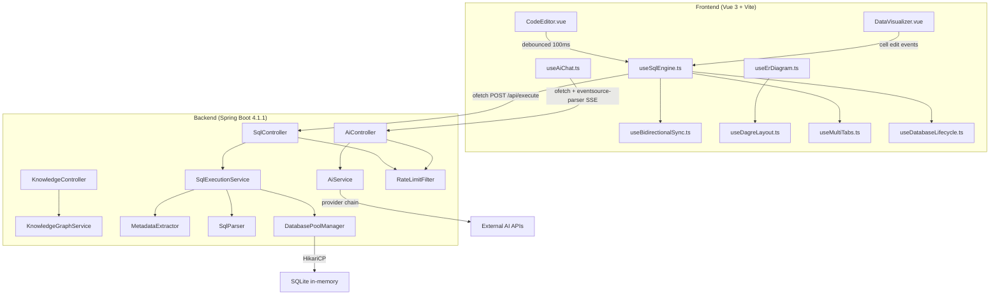

<!-- generated-by: gsd-doc-writer -->

# Architecture

## System overview

Sqlive is a full-stack SQL playground with a layered architecture: a Vue 3 browser-based code editor communicates with a Spring Boot backend over HTTP, which executes SQL against per-user in-memory SQLite databases and returns full schema snapshots. The system follows a **clear-and-re-execute** model -- each request either resets the database and executes the entire user script, or appends new statements to the existing state. Cell edits in the visualizer reverse-engineer SQL changes (UPDATE, INSERT, DELETE, CREATE TABLE, DROP TABLE) and re-execute. The architecture is split across two runtimes: a Node.js Vite dev server for the frontend and a Java 21 Spring Boot application for the backend.

## Component diagram



## Data flow

A typical SQL execution request flows through the system as follows:

1. **User types SQL** in `CodeEditor.vue`, which emits code changes to `useSqlEngine.ts`.
2. **Debounce** -- `useSqlEngine.ts` waits 100ms after the last keystroke (via `useDebounceFn` from VueUse, or 50ms in e2e mode), then fires `executeSqlRemote()`.
3. **HTTP request** -- The shared `src/lib/http.ts` ofetch client sends `POST /api/execute` with the full SQL script, an optional `dbName`, and a `reset` flag derived from `useDatabaseLifecycle.ts`. The `reset` flag is `true` on the first execution for a given database name (sets up a fresh in-memory DB) and on explicit submits.
4. **Rate limiting** -- `RateLimitFilter` delegates to `RequestRateLimiter`. Bucket4j atomically consumes per-IP, per-endpoint quotas (SQL: 500/min; AI: 100/min) with interval refill. Caffeine expires idle buckets after one window using the shared system scheduler. A rejected request returns HTTP 429 and `Retry-After`; active quotas are never reset by size eviction.
5. **Controller** -- `SqlController` validates the request, extracts `dbName` (defaults to `"default"`), and delegates to `SqlExecutionService.execute(script, dbName, reset)`.
6. **Database provisioning** -- `DatabasePoolManager.getOrCreateJdbcTemplate(dbName)` returns or creates a named SQLite in-memory database via `jdbc:sqlite:file:{name}?mode=memory` with a HikariCP pool (one connection per database). Runtime defaults are a soft limit of 500 databases, a hard ceiling of 2,000, 50 databases per non-local client IP, and 30-minute idle expiry. Leases protect active and queued requests; admission reclaims unused pools before refusing a request at the hard ceiling.
7. **Reset (if needed)** -- On `reset=true`, `clearDatabase()` drops user-created tables, views, and triggers from both `main` and `temp`. DROP names are schema-qualified, so a TEMP object cannot hide a main object from cleanup.
8. **Statement parsing** -- `SqlParser.parseStatementsPrecise()` splits the script into individual `SqlStatement` objects with UTF-16 offsets. It follows SQLite quoting rules: backslashes are ordinary string characters, doubled quote delimiters escape quotes, and bracket/backtick identifiers protect embedded semicolons. It tracks CASE expressions and groups BEGIN/END only inside CREATE TRIGGER bodies. Transaction BEGIN/COMMIT/ROLLBACK/END remain separate statements.
9. **Statement execution** -- A Spring `ConnectionCallback` borrows one connection for reset, all statements, and metadata. A `SingleConnectionDataSource` keeps nested JdbcTemplate calls on that connection. Each statement executes sequentially; transactions must close within this request. Unfinished BEGIN/SAVEPOINT transactions are rolled back and reported as errors, and a connection whose cleanup fails is evicted from HikariCP. Query results (SELECT statements) are captured via `MetadataExtractor.extractTableSchema()` and appended to a `queryResults` list.
10. **Metadata collection** -- After all statements run, `MetadataExtractor` queries the main/temp catalogs and `PRAGMA` tables to collect: table schemas (with column types and data), indexes, views, triggers, foreign keys, and execution metadata (duration, statement count). The existing API uses unqualified names; a same-named TEMP object takes display precedence, matching SQLite name resolution.
11. **Response** -- `SqlResponse.DataPayload` wraps the complete database state and returns as JSON to the frontend.
12. **State update** -- The engine immediately invalidates requests when source, tab, or database identity changes. Only a response matching the current request and source version may update results, saved status, canonical offsets, or session metadata. `useSqlEngine.ts` replaces `db.tables`, `db.queryResults`, `db.indexes`, etc. with the response data. Rows are assigned deterministic `_highlightId` hashes for change detection. New or modified rows trigger flash animations.

**Error flow:** If any statement fails, `SqlExecutionService` catches the exception, removes the `[SQLITE_ERROR]` prefix, uses `SqlParser.locateErrorLine()` to map the error to a line number, and returns `SqlResponse.error(message, line)`. On the frontend, both business and transport failures use one recovery path: the current reconciliation restores `lastValidCode`, reports a pending insert as failed, and clears the pending marker. A synchronous visual-edit boundary distinguishes generated changes from later manual typing; manual typing ends that reconciliation and settles its pending insert. Stale responses cannot roll back a different source or tab, and a failed manual request preserves its source text. Session-recreation metadata survives SQL errors and is exposed through CORS.

**AI chat flow:** The AI flow is separate. `AiController` exposes `/api/ai/chat` through separate JSON and SSE mappings selected by the Accept header, plus `/api/ai/analyze-error`, `/api/ai/fix-code`, `/api/ai/explain`, and `/api/ai/optimize`. `AiService` selects the configured provider (DeepSeek by default), builds a mode-specific system prompt via `PromptBuilder`, and routes to the provider's `streamChat()` or `complete()` implementation. Provider implementations (`DeepSeekProtocol`, `OllamaProtocol`, `LmStudioProtocol`, `OpenAiProtocol`) handle vendor-specific API formats. Frontend SSE framing uses eventsource-parser; ofetch handles HTTP, JSON, authentication and cancellation. Chat requests send only previous turns in history; generation ownership prevents cancelled streams from changing a newer request. Clearing or disposing a chat aborts its active stream.

## Key abstractions

| Abstraction | Location | Description |
|---|---|---|
| `useSqlEngine()` | `sqlive-frontend/src/composables/useSqlEngine.ts` | Central state machine managing SQL execution lifecycle, error handling, bidirectional sync, and multi-tab coordination. Modes: `user`, `reconciling`, `rollback`. |
| `useBidirectionalSync()` | `sqlive-frontend/src/composables/useBidirectionalSync.ts` | Updates uniquely identified VALUES tuples; ambiguous or generated-key rows use a precise UPDATE/DELETE by primary key. Without stable row identity, it reports an error and preserves SQL. Maintains `lastValidCode` for rollback. |
| `DatabaseModel` | `sqlive-frontend/src/model/DatabaseTypes.ts` | The canonical frontend data model: `tables[]`, `queryResults[]`, `indexes[]`, `views[]`, `triggers[]`, `foreignKeys[]`, `metadata`. |
| `SqlExecutionService` | `sqlive-backend/.../service/SqlExecutionService.java` | Orchestrates SQL execution: parse statements, execute each, collect metadata. The single entry point for all SQL operations from frontend. |
| `DatabasePoolManager` | `sqlive-backend/.../service/database/DatabasePoolManager.java` | Manages named SQLite databases using synchronized, access-ordered bookkeeping and explicit leases. Protects active/queued users, performs idle/LRU reclamation, and uses HikariCP for connections. |
| `SqlParser` | `sqlive-backend/.../service/sql/SqlParser.java` | SQL statement splitter with UTF-16 canonical offsets, quote and CASE handling, and trigger-specific BEGIN/END grouping. Returns `SqlStatement(sql, startLine)` records. |
| `MetadataExtractor` | `sqlive-backend/.../service/metadata/MetadataExtractor.java` | Collects full database metadata from `sqlite_master` and `PRAGMA` tables: tables with data, indexes, views, triggers, foreign keys. |
| `AiProvider` | `sqlive-backend/.../service/ai/AiProvider.java` | Interface for AI backends: `complete()` for non-streaming analysis, `streamChat()` for streaming SSE chat. Implemented by `OpenAiCompatibleProvider` with protocol-specific adapters. |
| `AiService` | `sqlive-backend/.../service/ai/AiService.java` | Manages AI provider lifecycle, builds mode-specific prompts via `PromptBuilder`, routes requests, parses JSON responses. |
| `RateLimitFilter` | `sqlive-backend/.../config/RateLimitFilter.java` | Thin servlet adapter around Bucket4j/Caffeine quota policy. Adds HTTP 429 and Retry-After. AI: 100 req/min, SQL: 500 req/min. |

## Directory structure rationale

```
sqlive/
├── sqlive-frontend/          # Vue 3 browser client
│   ├── src/
│   │   ├── assets/           # Static assets (default SQL, CSS)
│   │   ├── components/       # Vue components
│   │   │   ├── ai-elements/  # AI chat UI elements (conversation, messages, prompt input)
│   │   │   ├── chart/        # ECharts integration (option builder, theme, composable)
│   │   │   ├── er/           # ER diagram components (ErDiagram, ErTableNode, search/toolbar)
│   │   │   ├── knowledge/    # Knowledge graph UI (LearningCompanion, KnowledgeDetail, KnowledgePanel)
│   │   │   └── ui/           # Reka-ui v2 primitives (button, dialog, dropdown, etc.)
│   │   ├── composables/      # Stateful logic (useSqlEngine, useAiChat, useErDiagram, etc.)
│   │   ├── model/            # TypeScript type definitions (DatabaseTypes, ApiTypes, SchemaTypes)
│   │   ├── lib/              # Shared HTTP transport policy
│   │   ├── utils/            # Pure utility functions (SQL parsing, SSE, file I/O, formatting)
│   │   └── __tests__/        # Vitest unit + component tests, mirroring src/ structure
│   ├── tests/e2e/            # Playwright end-to-end tests
│   ├── vite.config.ts        # Vite build config, Vitest integration
│   └── package.json          # Dependencies and scripts
├── sqlive-backend/           # Spring Boot API server
│   └── src/
│       ├── main/java/com/douzi/sqlive/
│       │   ├── config/       # Spring config (WebConfig with CORS, RateLimitFilter, AiProperties)
│       │   ├── controller/   # REST controllers (SqlController, AiController, KnowledgeController, HealthController)
│       │   ├── dto/          # Request/response data objects (SqlRequest, SqlResponse, AI DTOs, schema DTOs)
│       │   │   └── ai/       # AI-specific DTOs (AiChatRequest, AiChatResponse, StreamChunk)
│       │   ├── exception/    # GlobalExceptionHandler and custom exceptions
│       │   └── service/      # Business logic
│       │       ├── ai/       # AI provider interface, protocol implementations, PromptBuilder
│       │       ├── database/ # DatabasePoolManager (SQLite per-user pooling)
│       │       ├── knowledge/# KnowledgeGraphService (static topic graph)
│       │       ├── metadata/ # MetadataExtractor (schema introspection)
│       │       ├── ratelimit/# Bucket4j quota policy and Caffeine bucket lifecycle
│       │       └── sql/      # SqlParser (statement splitting with depth tracking)
│       ├── main/resources/   # application.yml, knowledge-graph.json
│       └── test/java/        # JUnit 5 tests (mirroring main/java/ structure)
├── .planning/                # GSD planning artifacts (out of scope for this doc)
├── AGENTS.md                 # Project instructions and conventions
└── docs/                     # Documentation (this file)
```

The frontend follows Vue 3 composition API conventions: composables in `src/composables/` encapsulate stateful logic, components in `src/components/` handle rendering, `model/` holds shared type definitions, and `utils/` contains pure functions. The backend follows standard Spring Boot layered architecture: controllers handle HTTP, services contain business logic, and repository-like classes (`DatabasePoolManager`, `MetadataExtractor`, `SqlParser`) manage data access and processing. DTOs are separated into `dto/` with an `ai/` sub-package for AI-specific payloads. The `config/` package centralizes cross-cutting concerns (CORS, rate limiting, AI properties).


## Infrastructure and ownership boundaries

| Concern | Implementation | Responsibility retained by SQLive |
|---|---|---|
| HTTP | [ofetch](https://github.com/unjs/ofetch/tree/v1) in `src/lib/http.ts` | Endpoint selection and typed business envelopes; no automatic retries for SQL/AI; strict JSON; caller cancellation plus request deadlines; AI-only dynamic key headers |
| SSE framing | eventsource-parser | AI chunk semantics and request-generation ownership |
| Rate limiting | [Bucket4j](https://bucket4j.com/8.15.0/toc.html) + [Caffeine](https://github.com/ben-manes/caffeine/wiki/Eviction) | Endpoint quotas and HTTP response policy; one JVM's quotas are local to that instance |
| SQL connections | HikariCP + Spring JDBC | Session identity, leases, admission policy and request transaction boundaries |
| Reactive lifecycle | Vue + VueUse | Scope disposal, debouncing and timers; domain state remains in composables |

SQL reverse edits use canonical statement offsets and shared SQLite identifier helpers. Generated table/column identifiers are quoted. Deleting a table appends an explicit DROP TABLE statement while preserving prior SQL, rather than removing statements whose text happens to contain the table name.

Learning tasks use VueUse `createSharedComposable` to share one persisted task state across mounted consumers. Steps update progress; explicit completion owns `done` and `completedAt`. Reopening a completed step clears completion, while the existing per-topic task reward log prevents duplicate XP. Pagination synchronously clamps the current page when data shrinks and returns to page one when page size changes.

The fixes and their regression evidence are recorded in [ARCHITECTURE-REVIEW.md](ARCHITECTURE-REVIEW.md).
